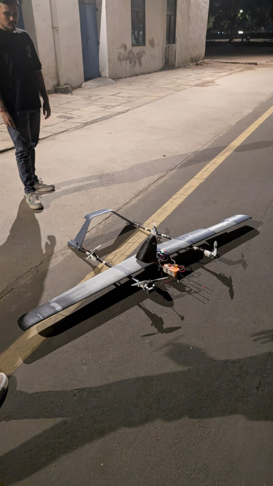
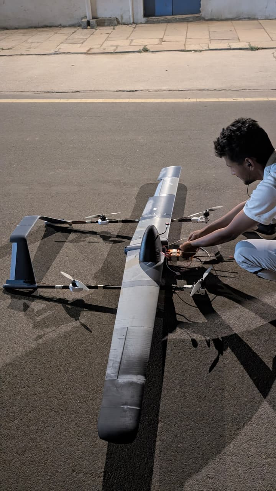
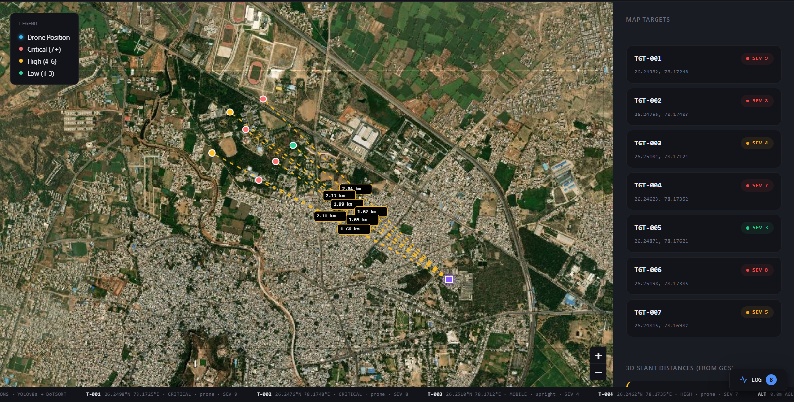
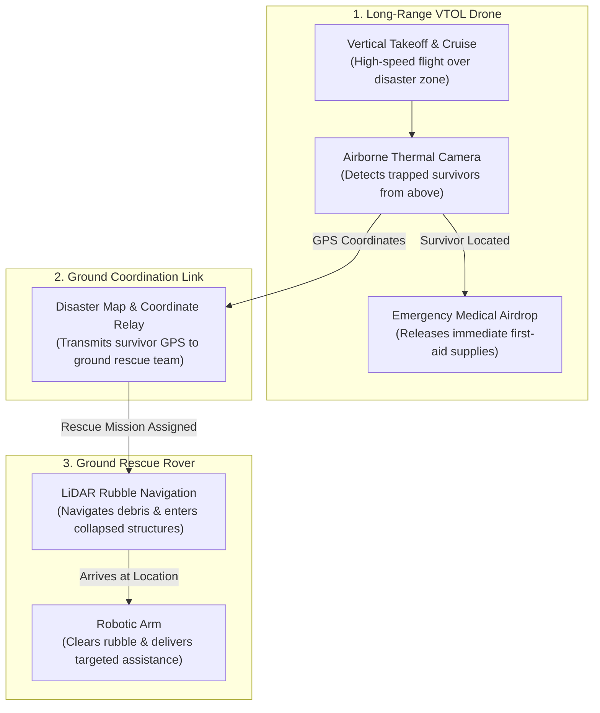

> **Engineering write-up:** Check out the full Project Jatayu blog on my portfolio website: [moksh.is-a.dev/#blog/jatayu-vtol](https://moksh.is-a.dev/#blog/jatayu-vtol)

<p align="center">
  <h1 align="center">JATAYU VTOL</h1>
  <p align="center">
    <strong>Autonomous Air-Ground Search & Rescue VTOL System with ROS 2 Autonomy, Edge Vision, and Tactical Ground Control Station</strong>
  </p>
</p>

<p align="center">
  <a href="https://github.com"></a>
  <a href="https://ardupilot.org"></a>
  <a href="https://fastapi.tiangolo.com"></a>
  <a href="https://react.dev"></a>
  <a href="https://github.com/ultralytics/ultralytics"></a>
  <a href="LICENSE"></a>
</p>

---

## Overview

**Jatayu** is a two-tier air-ground Search and Rescue (SAR) system built for **Hacksagon 2026** at ABV-IIITM Gwalior, where it won **1st Place** in the Disaster Management & Emergency Response track.

It pairs a **2.02-meter transition QuadPlane VTOL** with an autonomous **ground rescue rover** equipped with a **6-DOF Lewansoul robotic arm**:
1. **2.02m Hybrid VTOL Airframe**: Takes off vertically on four lift rotors, transitions in mid-air onto cambered `NACA 4412` to `NACA 2412` washout wings, delivers medical payloads via `SERVO11`, and relays survivor GPS coordinates to the ground team.
2. **ROS 2 Autonomy Stack (`autonomy/`)**: QuadPlane mission executive, MAVROS telemetry bridge, pinhole ray-casting target locator, and safety-interlocked payload controller, plus ArduPilot QuadPlane SITL configs (`simulation/`).
3. **Edge Vision & Tactical GCS (`gcs/`)**: FastAPI + React 19 + TypeScript ground station running `YOLOv8` + `BoT-SORT` (`bestyolov8s.pt` / `yolov8n-pose.pt` in this repo; `RT-DETR` + `BoT-SORT` + `OSNet` in the field pipeline), live MJPEG video streaming, and a Leaflet tactical map.
4. **Autonomous Ground Rescue Rover**: Runs `ROS 2 SLAM Toolbox` and `Nav2` with an `RPLiDAR A1` 2D scanner (`5 cm` occupancy grid) on an `NVIDIA Jetson Nano`, using `MoveIt 2` inverse kinematics to clear debris and retrieve payloads.

> **Repo scope note:** This repository contains the VTOL `ROS 2` autonomy packages, `ArduPilot QuadPlane SITL` configuration, and the `FastAPI` + `React 19` Tactical GCS. See the [blog post](https://moksh.is-a.dev/#blog/jatayu-vtol) for full field trial logs, hardware failures, and ground rover demos.

---

## Mission Gallery

<table align="center" width="100%">
  <tr>
    <td width="50%" align="center">
      <strong>Jatayu 2.02m QuadPlane VTOL</strong><br/>
      
    </td>
    <td width="50%" align="center">
      <strong>Field Avionics & Pre-Flight Configuration</strong><br/>
      
    </td>
  </tr>
  <tr>
    <td width="50%" align="center">
      <strong>Tactical Mission Control Kiosk</strong><br/>
      
    </td>
    <td width="50%" align="center">
      <strong>Geodesic Live Tactical Map</strong><br/>
      
    </td>
  </tr>
</table>

---

## System Architecture



---

## Key Features

- **Runway-Independent VTOL**: Vertical takeoff and hover via four lift motors, transitioning into fixed-wing flight with a 4-second motor overlap (`Q_TRANS_SPEED = 16.0 m/s`, `Q_ASSIST_SPEED = 13.0 m/s`).
- **Deterministic Mission State Machine**: Autonomous mission lifecycle in `mission_executive.py`: `STANDBY` -> `PREFLIGHT_CHECK` -> `VTOL_TAKEOFF` -> `TRANSITION_TO_FW` -> `WAYPOINT_SURVEY` -> `TARGET_APPROACH` -> `TRANSITION_TO_MC` -> `PRECISION_HOVER` -> `PAYLOAD_DELIVERY` -> `RTL` -> `VTOL_LAND`.
- **Direct Georeferencing**: `target_locator.py` casts rays through camera intrinsics (`fx = 950.0`, `1280x720`) rotated by UAV yaw, pitch, and roll to project detections onto WGS84 latitude/longitude.
- **Posture Triage & Tracking**: Classifies detected targets (`standing`, `distressed`, `lying_down` / `prone`) with `YOLOv8` + `BoT-SORT` and assigns severity scores from `1` to `10`.
- **Interlocked Payload Deployment**: `payload_controller.py` enforces velocity (`< 1.5 m/s` in `vtol_mission_params.yaml`) and altitude (`5 m` to `20 m`) checks before actuating `SERVO11` (`2000` PWM release).
- **Tactical Web GCS**: React 19 + TypeScript + Zustand + Leaflet kiosk backed by FastAPI over `MAVLink` (`tcp:127.0.0.1:5760` or Mission Planner HTTP telemetry at `127.0.0.1:56781/mavlink/`).

---

## Repository Structure

```text
jatayu/
├── .github/workflows/         # CI pipelines for ROS 2 build & GCS tests
├── autonomy/                  # ROS 2 Autonomy Flight Stack
│   ├── jatayu_msgs/           # Custom message & service definitions
│   │   ├── msg/               # DroneTelemetry.msg, TargetDetection.msg, PayloadStatus.msg
│   │   └── srv/               # DeployPayload.srv, SwitchFlightMode.srv
│   └── jatayu_autonomy/       # Core autonomy package
│       ├── config/            # vtol_mission_params.yaml
│       ├── launch/            # mavros_bridge, mission_autonomy, vtol_sitl launch files
│       ├── jatayu_autonomy/   # mission_executive, mavros_bridge, target_locator, payload_controller
│       └── test/              # Unit tests for executive and georeferencing
├── gcs/                       # Ground Control Station
│   ├── backend/               # FastAPI MAVLink & Computer Vision service
│   │   ├── app/               # REST routes, MAVLink service, video pipeline
│   │   ├── tests/             # Backend test suite
│   │   └── requirements.txt   # Cross-platform Python dependencies
│   └── frontend/              # React 19 + TypeScript Kiosk
│       ├── src/               # MissionControl, TacticalMap, PayloadDrop pages
│       └── package.json       # Frontend dependencies and Vite configuration
├── simulation/                # ArduPilot QuadPlane SITL simulation
│   ├── ardupilot/             # QuadPlane parameter configuration (quadplane.parm)
│   └── sitl_runner.sh         # Simulation startup runner
├── docs/                      # Technical Documentation
│   ├── assets/                # VTOL field photos & GCS screenshots
│   ├── architecture.md        # System architecture & subsystem breakdown
│   ├── hardware_specs.md      # Verified airframe, avionics & rover specs
│   └── ros2_autonomy.md       # ROS 2 topics, services, and operational guide
└── scripts/                   # Cross-platform setup, weight download & launch scripts
```

---

## Installation & Setup

### 1. Prerequisites
- **Operating System**: Ubuntu 22.04 LTS (for ROS 2 Humble) or Windows 10/11 (GCS only)
- **Python**: 3.10 or 3.11
- **Node.js**: v18+ (Node 20+ recommended)

### 2. Linux Installation
```bash
git clone https://github.com/danMoksh/jatayu.git
cd jatayu
./scripts/setup.sh
```

### 3. Windows Installation
```cmd
scripts\setup_gcs.bat
```

---

## Usage & Execution

### 1. Launch Ground Control Station (GCS)
- **On Linux**:
  ```bash
  ./scripts/start.sh
  ```
- **On Windows**:
  ```cmd
  scripts\start_gcs.bat
  ```
- **GCS Web Kiosk**: `http://localhost:5173`
- **FastAPI Interactive Docs**: `http://localhost:8080/docs`

### 2. Running with ROS 2 Autonomy (Ubuntu 22.04)
```bash
source /opt/ros/humble/setup.bash

mkdir -p ~/jatayu_ws/src
cp -r autonomy/* ~/jatayu_ws/src/
cd ~/jatayu_ws
colcon build --symlink-install
source install/setup.bash

ros2 launch jatayu_autonomy mission_autonomy.launch.py
```

### 3. Running ArduPilot QuadPlane SITL Simulation
```bash
./simulation/sitl_runner.sh
```

---

## Telemetry & MAVLink API Reference

All REST endpoints are mounted under `/api` on the FastAPI backend (`port 8080`):

| Method | Endpoint | Description |
| :--- | :--- | :--- |
| `GET` | `/api/telemetry` | Latest GPS fix, heading, altitude, airspeed, and battery status. |
| `GET` | `/api/health` | Service health status for MAVLink link, AI model, and video stream. |
| `POST` | `/api/drone/mode` | Sets flight mode (`QHOVER`, `QLOITER`, `AUTO`, `GUIDED`, `RTL`). |
| `POST` | `/api/drone/altitude` | Updates target guided altitude in meters. |
| `GET` | `/api/targets` | Lists all saved survivor detections and georeferenced points. |
| `POST` | `/api/payload/drop` | Commands payload release over designated target coordinates. |
| `GET` | `/api/video/stream` | Streams MJPEG video frames with AI detection bounding box overlays. |

---

## Verified Hardware & Airframe Summary

| Subsystem | Verified Specification | Notes |
| :--- | :--- | :--- |
| **Airframe** | `2.02 m` (`2020 mm`) QuadPlane VTOL | `3,684 cm^2` wing area, `10.79` aspect ratio, A-tail, `6 kg` MTOW |
| **Wing Airfoils** | `NACA 4412` root -> `NACA 2412` tip | Geometric washout twist (`2.0 deg` root to `1.0 deg` tip incidence) |
| **Power Architecture** | `4S 2000 mAh LiPo` + `4S6P 21,000 mAh Li-Ion` | Separate lift burst pack and fixed-wing cruise pack |
| **Autopilot** | `ArduPilot ArduPlane` (`Q_ENABLE=1`) | Field unit ran custom-compiled firmware on a scavenged `DAKEFPV` STM32 FC after a `SpeedyBee F405` 5V bus short |
| **Payload Actuator** | `SERVO11` (`SERVO11_FUNCTION=28`) | PWM `1000` locked / `2000` release (`quadplane.parm`) |
| **Ground Rover** | `NVIDIA Jetson Nano` + `RPLiDAR A1` | `ROS 2 SLAM Toolbox` (`5 cm` occupancy grid) + `Nav2` |
| **Manipulator** | `6-DOF Lewansoul` robotic arm | Driven via `MoveIt 2` inverse kinematics for debris clearance |

See [docs/hardware_specs.md](docs/hardware_specs.md) for the full airframe, firmware recovery, and rover breakdown.

---

## Contributing

Issues and pull requests are welcome.

1. Fork the repository
2. Create a feature branch (`git checkout -b feature/your-change`)
3. Commit your changes (`git commit -m 'feat: describe your change'`)
4. Push the branch (`git push origin feature/your-change`)
5. Open a pull request

---

## License

This project is licensed under the Apache License 2.0. See [LICENSE](LICENSE) for details.
