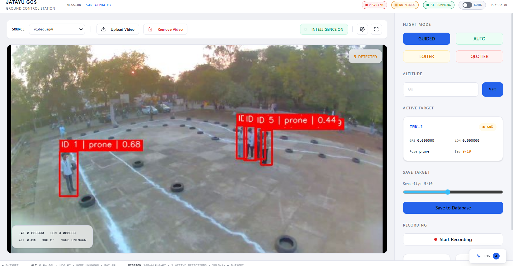
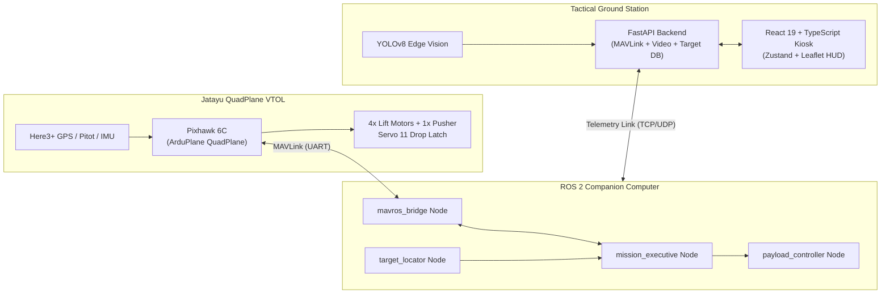

<p align="center">
  <h1 align="center"> JATAYU VTOL</h1>
  <p align="center">
    <strong>Autonomous Search-and-Rescue VTOL UAV with ROS 2 Autonomy, Edge AI Vision, and Tactical Ground Control Station</strong>
  </p>
</p>

<p align="center">
  <a href="https://github.com"></a>
  <a href="https://ardupilot.org"></a>
  <a href="https://fastapi.tiangolo.com"></a>
  <a href="https://react.dev"></a>
  <a href="https://github.com/ultralytics/ultralytics"></a>
  <a href="LICENSE"></a>
</p>

---

## Overview

**Jatayu** is an open-source, full-stack autonomous aerial robotics platform designed for search-and-rescue (SAR), tactical reconnaissance, and targeted medical payload delivery.

Named after the divine bird *Jatayu*—symbol of vigilance and selfless rescue—this platform unites a hybrid Vertical Take-Off & Landing (VTOL) QuadPlane airframe with an intelligent companion compute flight stack:
1. **Hybrid VTOL Airframe**: Combines the runway-free convenience of a multirotor with the long endurance and speed of a fixed-wing aircraft.
2. **ROS 2 Autonomy Stack**: Autonomous state machine coordinating takeoff, fixed-wing transition, search-grid navigation, target hover, and precision payload drop.
3. **Edge AI Computer Vision**: Real-time human target detection and skeletal pose triage via YOLOv8, combined with direct georeferencing to pinpoint survivors on ground maps.
4. **Tactical Ground Control Station (GCS)**: Industrial-grade web kiosk powered by React 19, TypeScript, and FastAPI, providing real-time telemetry HUD, geodesic routing, and video streaming.

---

## Mission Gallery

<table align="center" width="100%">
  <tr>
    <td width="50%" align="center">
      <strong>Tactical Mission Control Kiosk</strong><br/>
      
    </td>
    <td width="50%" align="center">
      <strong>Geodesic Live Tactical Map</strong><br/>
      
    </td>
  </tr>
  <tr>
    <td width="50%" align="center">
      <strong>3D-Printed Spar Nacelle Assembly</strong><br/>
      
    </td>
    <td width="50%" align="center">
      <strong>Transition Bracket & Motor Mount</strong><br/>
      
    </td>
  </tr>
</table>

---

## ️ System Architecture



---

## Key Features

- **Runway-Independent VTOL**: Vertical takeoff and landing via quadcopter motors, followed by forward pusher acceleration to high-speed fixed-wing flight.
- **Deterministic Mission State Machine**: Fully autonomous mission lifecycle (`STANDBY`  `VTOL_TAKEOFF`  `TRANSITION_TO_FW`  `SEARCH_PATROL`  `PRECISION_HOVER`  `PAYLOAD_DROP`  `RTL`).
- **Direct Georeferencing**: Pinpoints ground survivor coordinates (WGS84 lat/long) directly from optical video camera pixels and UAV pitch/yaw/altitude.
- **Skeletal Pose Triage**: Classifies victim posture (`standing`, `distressed`, `lying_down`) to automatically assign triage severity scores from 1 (stable) to 10 (critical).
- **Interlocked Payload Deployment**: Prevents accidental releases through multi-condition safety checks (ground velocity < 1.5 m/s, altitude envelope between 5m and 20m).
- **Tactical Web GCS**: Dual-theme (Light/Dark) industrial kiosk providing sub-second telemetry updates, MJPEG camera streams, geodesic route lines, and mission recordings.

---

## Repository Structure

```
jatayu/
├── .github/workflows/         # CI pipelines for ROS 2 build & GCS tests
├── autonomy/                  # ROS 2 Autonomy Flight Stack
│   ├── jatayu_msgs/           # Custom message & service definitions
│   │   ├── msg/               # DroneTelemetry.msg, TargetDetection.msg, PayloadStatus.msg
│   │   └── srv/               # DeployPayload.srv, SwitchFlightMode.srv
│   └── jatayu_autonomy/       # Core autonomy package
│       ├── config/            # Flight & camera calibration parameters
│       ├── launch/            # ROS 2 launch orchestrations
│       ├── jatayu_autonomy/   # mission_executive, mavros_bridge, target_locator, payload_controller
│       └── test/              # Unit tests for executive and georeferencing
├── gcs/                       # Ground Control Station
│   ├── backend/               # FastAPI MAVLink & Computer Vision service
│   │   ├── app/               # REST routes, MAVLink service, video pipeline
│   │   ├── tests/             # Backend test suite
│   │   └── requirements.txt   # Cross-platform Python dependencies
│   └── frontend/              # React 19 + TypeScript Kiosk
│       ├── src/               # MissionControl, TacticalMap, PayloadDrop pages
│       └── package.json       # Frontend dependencies and Vite configuration
├── simulation/                # ArduPilot QuadPlane SITL simulation
│   ├── ardupilot/             # QuadPlane parameter configuration (quadplane.parm)
│   └── sitl_runner.sh         # Simulation startup runner
├── docs/                      # Technical Documentation
│   ├── assets/                # Curated high-res UI & airframe imagery
│   ├── architecture.md        # In-depth system architecture & diagrams
│   ├── hardware_specs.md      # Physical airframe, BOM & 3D printing specs
│   └── ros2_autonomy.md       # ROS 2 topics, services, and operational guide
└── scripts/                   # Cross-platform installation and launch scripts
```

---

## ️ Installation & Setup

### 1. Prerequisites
- **Operating System**: Ubuntu 22.04 LTS (recommended for ROS 2) or Windows 10/11
- **Python**: 3.10 or 3.11
- **Node.js**: v18+ (Node 20+ recommended)

### 2. Linux Installation
```bash
# Clone the repository
git clone https://github.com/danMoksh/jatayu.git
cd jatayu

# Run one-touch automated setup
./scripts/setup.sh
```

### 3. Windows Installation
```cmd
REM Run setup script to configure Python virtualenv and install Node modules
scripts\setup_gcs.bat
```

---

## Usage & Execution

### 1. Launch Ground Control Station (GCS)
- **On Linux**:
  ```bash
  ./scripts/start.sh
  ```
- **On Windows**:
  ```cmd
  scripts\start_gcs.bat
  ```
- **GCS Web Kiosk**: Open `http://localhost:5173`
- **FastAPI Interactive Docs**: Open `http://localhost:8080/docs`

### 2. Running with ROS 2 Autonomy (Ubuntu 22.04)
```bash
# Source ROS 2 Humble
source /opt/ros/humble/setup.bash

# Build the workspace
cd ~/jatayu/autonomy
colcon build --symlink-install
source install/setup.bash

# Launch full mission autonomy
ros2 launch jatayu_autonomy mission_autonomy.launch.py
```

### 5. Running ArduPilot QuadPlane SITL Simulation
```bash
./simulation/sitl_runner.sh
```

---

## Telemetry & MAVLink API Reference

The FastAPI backend exposes RESTful endpoints for integration:

| Method | Endpoint | Description |
| :--- | :--- | :--- |
| `GET` | `/api/telemetry` | Retrieves latest GPS fix, heading, altitude, airspeed, and battery status. |
| `GET` | `/api/health` | System health check (MAVLink link, AI model status, camera stream status). |
| `POST` | `/api/drone/mode` | Sets flight mode (`QHOVER`, `QLOITER`, `AUTO`, `GUIDED`, `RTL`). |
| `POST` | `/api/drone/altitude` | Updates target guided altitude in meters. |
| `GET` | `/api/targets` | Lists all detected survivors and georeferenced points. |
| `POST` | `/api/payload/drop` | Commands payload release over designated target coordinates. |
| `GET` | `/api/video/stream` | Streams real-time MJPEG camera feed with overlaid AI detection bounding boxes. |

---

## ️ Hardware Bill of Materials (BOM)

| Component | Part / Model | Purpose |
| :--- | :--- | :--- |
| **Airframe** | 1800mm High-Lift QuadPlane | Composite aerodynamic fuselage & wings |
| **Lift Motors** | 4x Sunnysky 2216 880KV | Vertical takeoff and hover propulsion |
| **Pusher Motor** | 1x Sunnysky 2814 1000KV | Forward horizontal cruise propulsion |
| **Propellers** | 10x4.5 CF (Lift) / 9x6 Folding (Pusher) | Aerodynamic thrust with low drag in cruise |
| **Flight Controller** | Holybro Pixhawk 6C / Cube Orange | Primary flight control and stabilization |
| **GPS / Compass** | Here3+ Dual RTK GNSS | High-precision satellite navigation |
| **Companion Compute** | Jetson Orin Nano / RPi 5 | ROS 2 autonomy & YOLOv8 edge inference |
| **Payload Actuator** | Metal Gear MG996R Servo | Reliable release mechanism for medical cargo |

Detailed fabrication instructions and 3D printing configurations are documented in [docs/hardware_specs.md](docs/hardware_specs.md).

---

## Contributing

Contributions to the Jatayu project are warmly welcomed! Please check out the [Issues](https://github.com/danMoksh/jatayu/issues) tab for open tasks or submit a Pull Request following our code guidelines.

1. Fork the Project
2. Create your Feature Branch (`git checkout -b feature/AmazingFeature`)
3. Commit your Changes (`git commit -m 'feat: Add AmazingFeature'`)
4. Push to the Branch (`git push origin feature/AmazingFeature`)
5. Open a Pull Request

---

## License

This project is licensed under the Apache License 2.0. See the [LICENSE](LICENSE) file for details.
