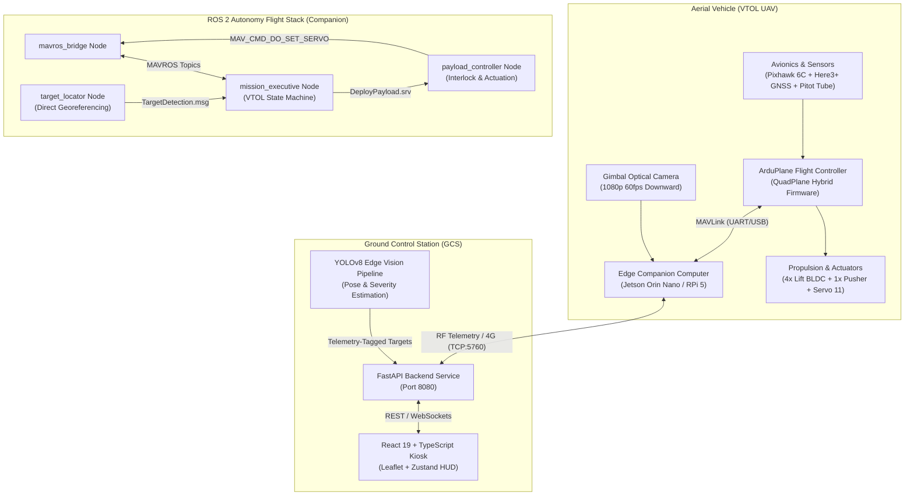

# JATAYU System Architecture & Technical Specifications

Jatayu is a cyber-physical aerial robotics platform combining a hybrid Vertical Take-Off and Landing (VTOL) QuadPlane UAV, a ROS 2 autonomous mission flight stack, an edge-accelerated computer vision target pipeline, and a modern Ground Control Station (GCS) kiosk.

---

## 1. High-Level System Architecture

---

## 2. Core Subsystems

### 2.1 Aerial Autopilot & Hybrid VTOL Transitions
The aircraft employs ArduPilot ArduPlane configured for QuadPlane mode (`Q_ENABLE=1`). 
- **Vertical Phase**: 4 lift motors operate in multirotor orientation (`QHOVER`/`QLOITER`) for runway-free vertical takeoff and landing.
- **Transition Phase**: Once above obstacle clearance altitude (30m+ AGL), the forward pusher motor initiates acceleration. Multirotor assist remains active until airspeed exceeds stall threshold (16 m/s).
- **Fixed-Wing Cruise Phase**: Multirotor motors shut down, folding propellers reduce drag, and aerodynamic lift sustains transit at 20 m/s for up to 55 minutes.
- **Hover & Delivery Phase**: Upon target acquisition, the aircraft transitions back into multirotor hover over the target coordinates, verifies descent safety limits (12m AGL), and actuates the payload release.

### 2.2 ROS 2 Autonomy Engine
The `jatayu_autonomy` package handles mission-level decisions without continuous operator intervention:
- **`mission_executive`**: An event-driven state machine managing takeoff, transition, lawnmower search patterns, hover loiter, payload drop, and RTL.
- **`mavros_bridge`**: Normalizes MAVLink and MAVROS telemetry streams into unified ROS 2 message formats (`jatayu_msgs/DroneTelemetry`).
- **`target_locator`**: Ingests bounding box detections from the camera stream, combines them with UAV altitude, gimbal pitch, and heading, and computes accurate ground coordinates (WGS84).
- **`payload_controller`**: Enforces critical safety interlocks (altitude limits, ground velocity ceilings, drop confirmations) before commanding the drop servo.

### 2.3 Edge Computer Vision Pipeline
- **Model**: Ultralytics YOLOv8 pose estimation model (`yolo26n-pose.pt` / `yolov8n.pt`).
- **Target Profiling**: Detects human subjects in disaster zones, extracts skeletal keypoints to determine target state (`standing`, `distressed`, `lying_down`), and assigns an automated triage severity score (1 to 10).
- **Geographic Tagging**: Instantaneously joins bounding box coordinates with aircraft GPS telemetry, persisting detections to local target stores.

### 2.4 Ground Control Station (GCS)
- **Backend (FastAPI)**: Lightweight, asynchronous API service managing MAVLink telemetry sockets, MJPEG camera streams, target databases, and operator action logs.
- **Frontend (React 19 + Vite + Zustand + Leaflet)**: Accessible industrial kiosk interface providing:
  - Tactical 2D/3D map with dynamic flight paths, geodesic routing, and target breadcrumbs.
  - Live video stream HUD with computer vision bounding box overlays.
  - Real-time vehicle telemetry indicators (battery voltage, groundspeed, airspeed, GPS satellite health).
  - One-click mode switching and safety-latched payload release buttons.
