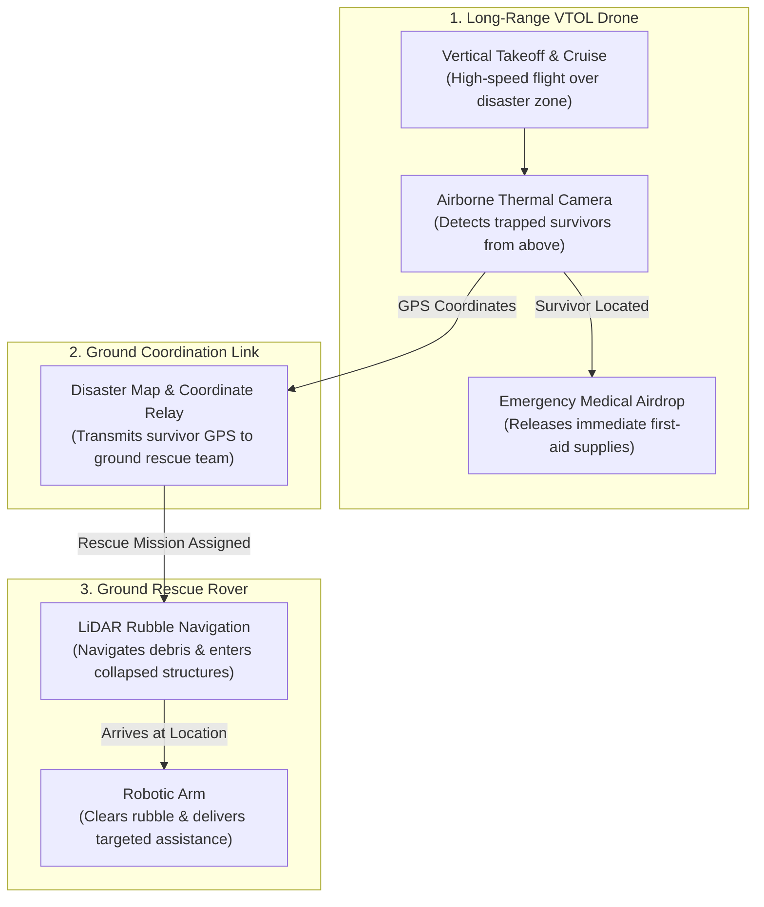

# JATAYU System Architecture & Technical Specifications

> **Engineering write-up:** Check out the full Project Jatayu blog on my portfolio website: [moksh.is-a.dev/#blog/jatayu-vtol](https://moksh.is-a.dev/#blog/jatayu-vtol)

Jatayu is an integrated air-ground Search and Rescue (SAR) system combining a **2.02m hybrid QuadPlane VTOL UAV**, a **ROS 2 autonomous mission stack**, a **FastAPI + React 19 Tactical Ground Control Station (GCS)**, and an **autonomous ground rescue rover**.

---

## 1. End-to-End Air-Ground Architecture

---

## 2. Core Subsystems

### 2.1 Aerial Autopilot & Hybrid VTOL Transitions
The aircraft runs ArduPilot ArduPlane configured in QuadPlane mode (`Q_ENABLE=1`):
- **Vertical Phase (`QLOITER` / `QHOVER`)**: Four vertical lift motors handle runway-free takeoff and landing.
- **Transition Phase**: Above `30-35 m` AGL (`cruise_altitude_m: 35.0` in `vtol_mission_params.yaml`), the rear pusher accelerates while vertical rotors hold altitude across a 4-second motor overlap (`Q_TRANS_SPEED = 16.0 m/s`, `Q_ASSIST_SPEED = 13.0 m/s`, `Q_TRANSITION_MS = 5000` in `quadplane.parm`).
- **Fixed-Wing Cruise Phase**: Custom washout wings (`NACA 4412` root to `NACA 2412` tip) carry the airframe through search grids.
- **Hover & Delivery Phase**: Transitions back to multirotor hover over target coordinates, checks safety interlocks (`5-20 m` AGL, `< 1.5 m/s` ground velocity), and actuates `SERVO11` (`2000` PWM).

### 2.2 ROS 2 Autonomy Engine (`autonomy/jatayu_autonomy`)
- **`mission_executive`**: State machine orchestrating `STANDBY`, `PREFLIGHT_CHECK`, `VTOL_TAKEOFF`, `TRANSITION_TO_FW`, `WAYPOINT_SURVEY`, `TARGET_APPROACH`, `TRANSITION_TO_MC`, `PRECISION_HOVER`, `PAYLOAD_DELIVERY`, `RTL`, and `VTOL_LAND`.
- **`mavros_bridge`**: Normalizes MAVROS topics into `jatayu_msgs/DroneTelemetry` (`10 Hz`).
- **`target_locator`**: Projects bounding box pixel coordinates (`fx = 950.0`, `1280x720`) through aircraft attitude (yaw, pitch, roll) and altitude to WGS84 coordinates.
- **`payload_controller`**: Enforces altitude and hover velocity constraints before sending `MAV_CMD_DO_SET_SERVO` on channel `11`.

### 2.3 Computer Vision & GCS (`gcs/`)
- **GCS Backend (`gcs/backend`)**: FastAPI service handling MAVLink commands (`tcp:127.0.0.1:5760` or Mission Planner HTTP telemetry), MJPEG streaming, WebSockets, and `YOLOv8` + `BoT-SORT` inference (`bestyolov8s.pt` / `yolov8n-pose.pt`) with pose triage (`standing`, `distressed`, `lying_down` / `prone`) and severity scoring (`1-10`).
- **Field Aerial Vision Pipeline**: The field deployment documented in the portfolio blog uses `RT-DETR` paired with `BoT-SORT` and `OSNet` appearance embeddings to keep survivor tracking IDs consistent under altitude changes and partial occlusion.
- **GCS Frontend (`gcs/frontend`)**: React 19 + TypeScript + Vite + Zustand + Leaflet kiosk displaying live telemetry, geodesic slant distances, target lists, and video overlays.

### 2.4 Ground Rescue Rover
- **Compute & Sensing**: `NVIDIA Jetson Nano` running `ROS 2 SLAM Toolbox` and `Nav2` with an `RPLiDAR A1` 2D rangefinder (`5 cm` indoor occupancy grid).
- **Manipulation**: `6-DOF Lewansoul` robotic arm controlled with `MoveIt 2` inverse kinematics to clear rubble and retrieve payloads in collapsed structures.
