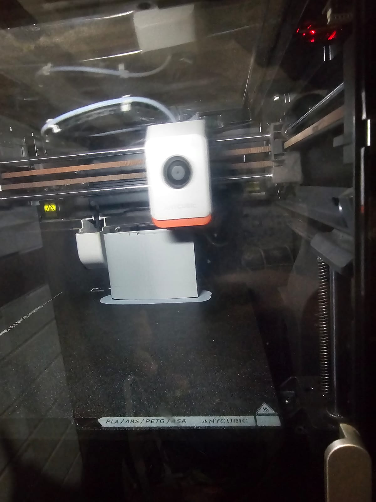
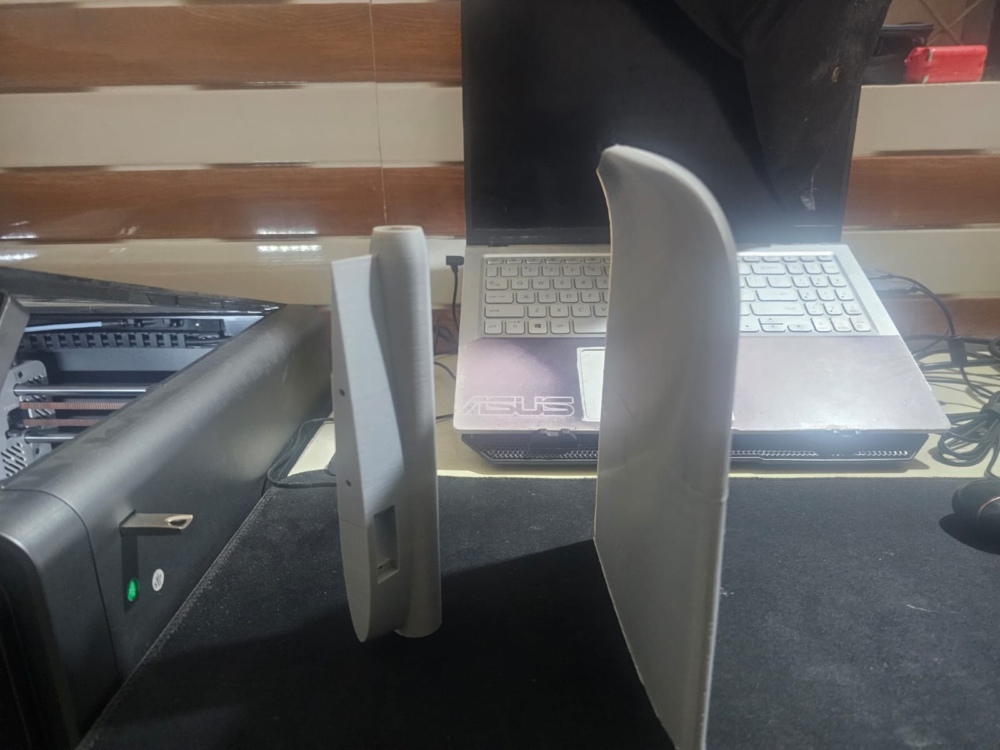

# JATAYU VTOL — Hardware Specifications & Airframe Architecture

The **Jatayu VTOL** is a hybrid Vertical Take-Off and Landing Unmanned Aerial Vehicle (UAV) designed for rapid deployment in search-and-rescue, tactical reconnaissance, and targeted medical payload delivery.

---

## 1. Airframe Configuration

| Parameter | Specification | Notes |
| :--- | :--- | :--- |
| **Configuration** | QuadPlane Hybrid VTOL | 4 Multirotor lift motors + 1 Forward pusher |
| **Wingspan** | 1,800 mm | High-lift aerofoil with detachable wings |
| **Fuselage Length** | 1,120 mm | Aerodynamic composite / reinforced polymer |
| **Empty Weight (dry)** | 1,650 g | Including airframe and motor brackets |
| **Max Takeoff Weight (MTOW)** | 3,800 g | Including 4S battery and 600g payload |
| **Cruise Speed (Fixed Wing)** | 18–22 m/s (65–80 km/h) | Optimal lift-to-drag efficiency |
| **Stall Speed** | 11 m/s | Safe transition threshold back to multirotor |
| **Hover Endurance** | 12 minutes | Multirotor hover mode |
| **Cruise Endurance** | 55 minutes | Fixed-wing transit mode |
| **Operational Radius** | 25 km | Line-of-Sight RF telemetry / 4G link |

---

## 2. 3D-Printed Structural Components

Critical transition mounts and the payload drop bay are custom engineered and 3D printed using high-durability carbon-fiber reinforced PETG (CF-PETG) to minimize structural mass while maintaining rigid torsional stability during motor transition.

  
  

### Fabricated Assemblies:
1. **Carbon Spar Nacelle Brackets**: Clamps securely onto 16mm carbon fiber boom tubes, mounting the 4x vertical lift brushless motors.
2. **Payload Release Bay**: Micro-servo actuated latching clamp engineered for safe carry and one-touch release of emergency medical modules.
3. **Avionics & Optical Pod Housing**: Vibration-isolated gimbal mount for downward-facing optical camera sensor.

---

## 3. Avionics & Propulsion Stack

### Flight Controller & Navigation
- **Autopilot Unit**: Holybro Pixhawk 6C / Cube Orange (STM32H753, 480 MHz)
- **Firmware**: ArduPilot ArduPlane (QuadPlane mode, `Q_ENABLE=1`)
- **GNSS / Compass**: Here3+ Precision GNSS with dual RTK capability
- **Airspeed Sensor**: MS5525 digital differential pitot tube
- **Companion Computer**: NVIDIA Jetson Orin Nano / Raspberry Pi 5 (running ROS 2 Humble & YOLO vision inference)

### Propulsion System
- **VTOL Lift Motors**: 4x Sunnysky 2216 880KV Brushless DC motors
- **VTOL Propellers**: 10x4.5 inch Carbon Fiber Quick-Release
- **Forward Pusher Motor**: 1x Sunnysky 2814 1000KV Motor
- **Forward Propeller**: 9x6 inch High-Efficiency APC Folding Prop
- **ESCs**: 4x 30A BLHeli_S (VTOL lift) + 1x 40A OPTO (Forward pusher)

### Payload Mechanism
- **Actuation**: Metal-gear MG996R servo
- **Interface**: MAVLink `SERVO11` PWM trigger (2000µs release state)
- **Fail-Safe**: Mechanical detent preventing accidental release below threshold airspeed or outside designated hover envelopes.
