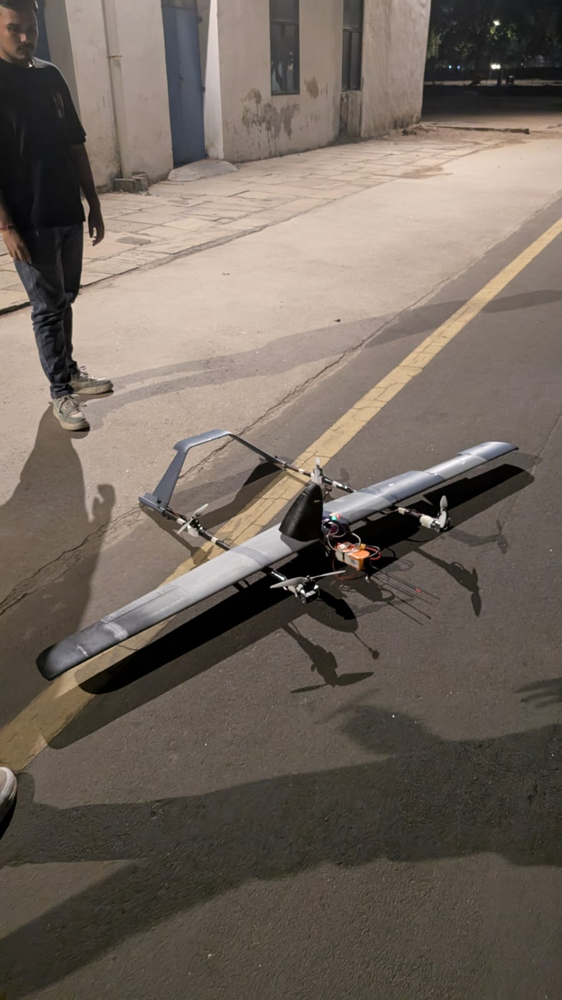

# JATAYU VTOL & Ground Rover Hardware Specifications

> **Engineering write-up:** Check out the full Project Jatayu blog on my portfolio website: [moksh.is-a.dev/#blog/jatayu-vtol](https://moksh.is-a.dev/#blog/jatayu-vtol)

This document lists the verified airframe, avionics, power, and ground rover hardware specifications from the **Jatayu** build and competition logs (**Hacksagon 2026**, 1st Place, ABV-IIITM Gwalior).

---

## 1. Aerial VTOL Airframe

| Parameter | Verified Specification | Notes |
| :--- | :--- | :--- |
| **Configuration** | Hybrid QuadPlane VTOL | 4 vertical lift motors + 1 rear pusher, A-tail empennage |
| **Wingspan** | `2.02 m` (`2,020 mm`) | Custom geometric washout twist |
| **Wing Area** | `3,684 cm^2` (`0.3684 m^2`) | Aspect ratio `10.79` |
| **Root Airfoil** | `NACA 4412` (`220 mm` chord) | `2.0 deg` angle of incidence for low-speed lift |
| **Tip Airfoil** | `NACA 2412` (`117 mm` chord) | `1.0 deg` angle of incidence (`1 deg` washout) to delay tip stall |
| **Max Takeoff Weight (MTOW)** | `6 kg` | Airframe, dual battery packs, avionics, and medical payload |
| **Fixed-Wing Cruise Speed** | `45-65 km/h` (`~18 m/s` SITL trim) | `TRIM_ARSPD_CM = 1800` in `simulation/ardupilot/quadplane.parm` |
| **Transition Thresholds** | `16.0 m/s` forward / `13.0 m/s` assist | `4 s` motor overlap during transition (`Q_TRANSITION_MS = 5000` in SITL) |

---

## 2. Airframe Field Photos

  
  

---

## 3. Dual-Battery Power Architecture

Vertical takeoff demands high burst current, while fixed-wing cruise needs energy density:
- **VTOL Lift Pack**: `4S 2000 mAh LiPo` dedicated to the four vertical lift motors during hover and transition.
- **Fixed-Wing Cruise Pack**: `4S6P 21,000 mAh Li-Ion (18650)` dedicated to forward pusher cruise.

---

## 4. Flight Control, Avionics & Payload Release

- **Firmware**: `ArduPilot ArduPlane` (`QuadPlane` mode, `Q_ENABLE=1`).
- **Field Flight Controller Recovery**: During pre-demo bench testing at 2:00 AM, a `5V` bus short burned out the primary `SpeedyBee F405` flight controller. We scavenged an unbranded `DAKEFPV` STM32 flight controller, traced motor and elevon pins with a multimeter, and compiled custom `ArduPlane` firmware mappings before morning flight demos.
- **Payload Actuation (`quadplane.parm` & `vtol_mission_params.yaml`)**: Underbelly drop mechanism wired to `SERVO11` (`SERVO11_FUNCTION = 28`, PWM `1000` locked, `2000` release), gated by `5-20 m` AGL altitude and `< 1.5 m/s` hover velocity interlocks.

---

## 5. Ground Rescue Rover

- **Compute**: `NVIDIA Jetson Nano`
- **Mapping & Navigation**: `RPLiDAR A1` 2D rangefinder feeding `ROS 2 SLAM Toolbox` (`5 cm` occupancy grid) and `Nav2` for GPS-denied indoor rubble traversal
- **Manipulator**: `6-DOF Lewansoul` robotic arm driven via `MoveIt 2` inverse kinematics for debris clearance and payload retrieval
